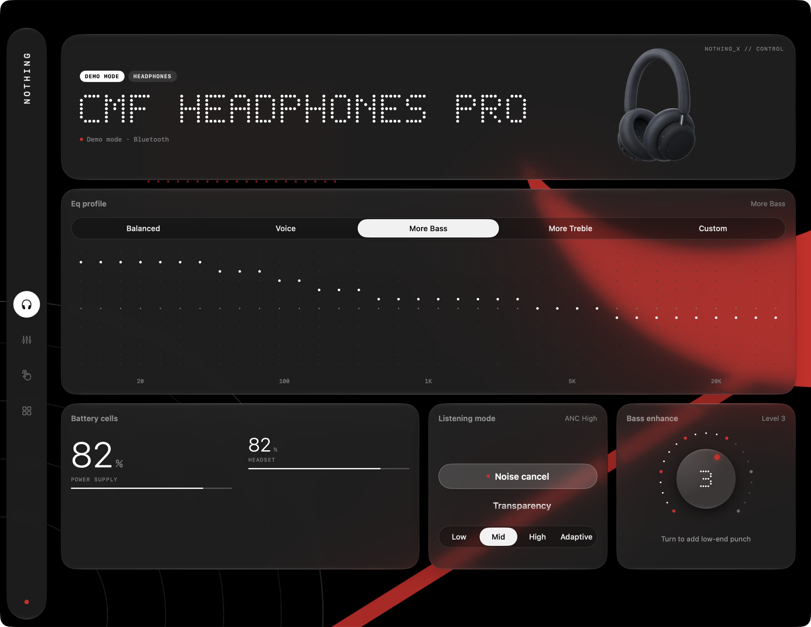
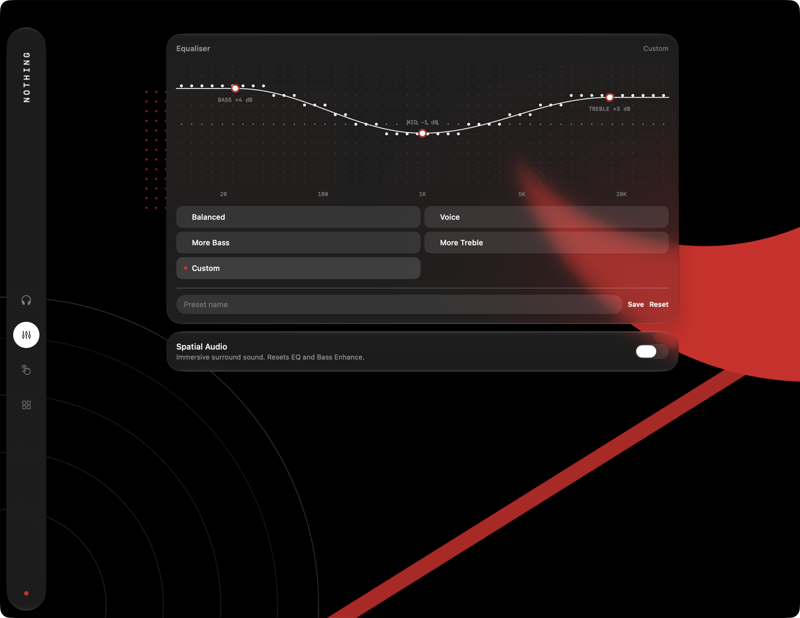
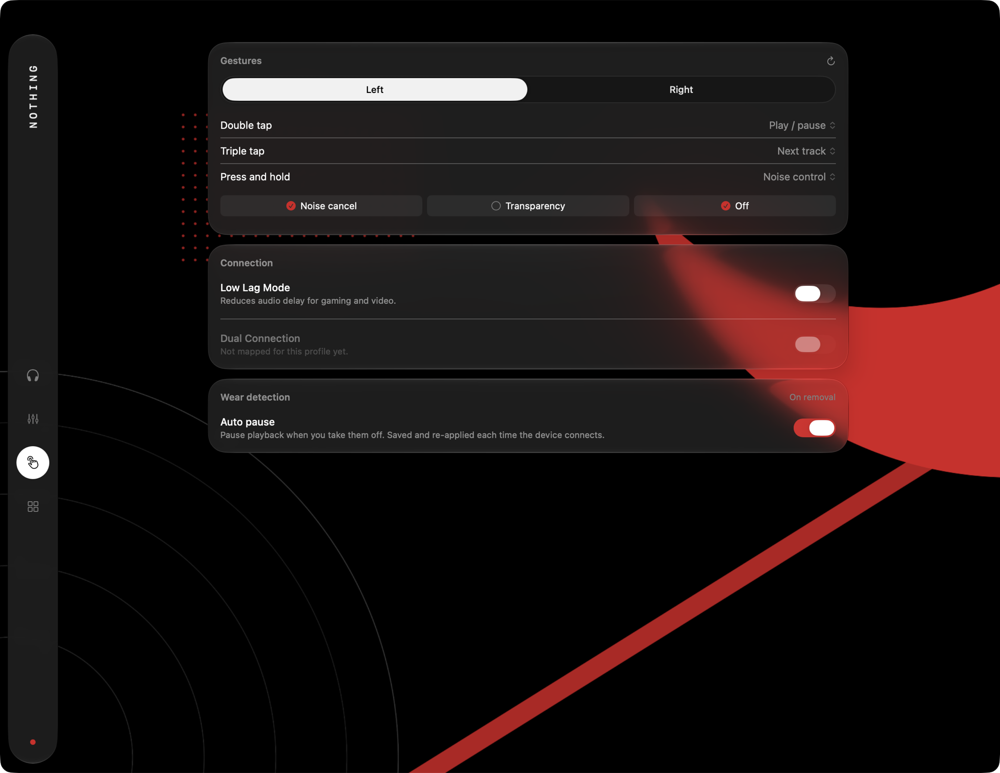
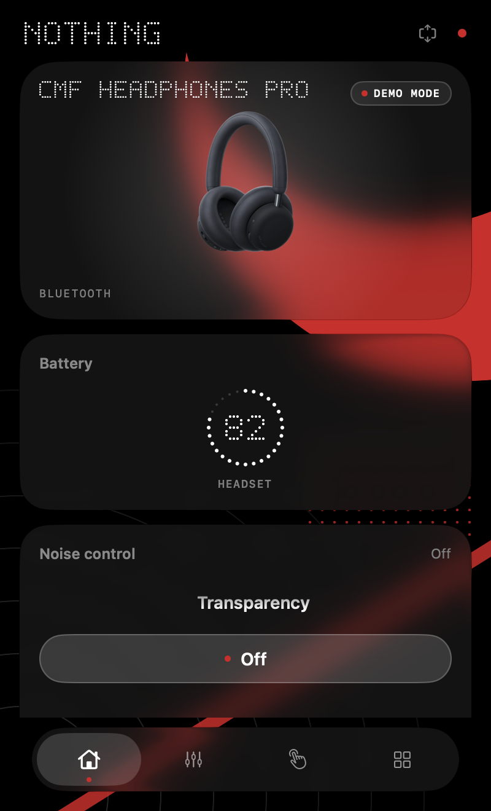
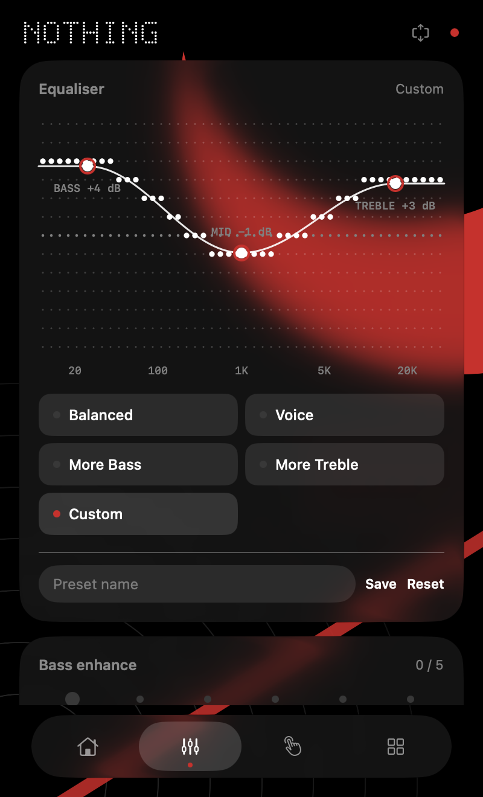
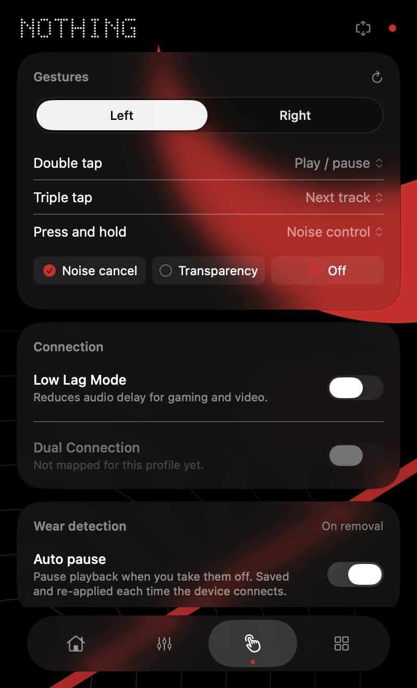
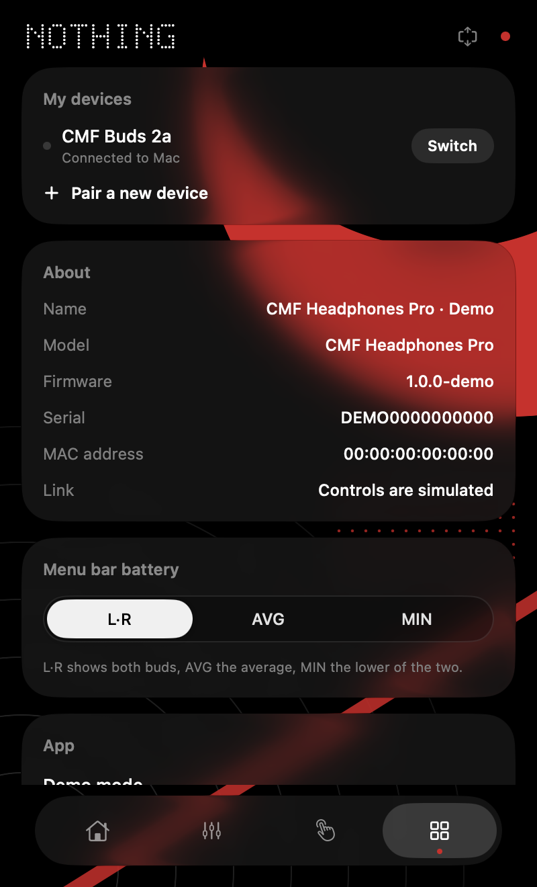
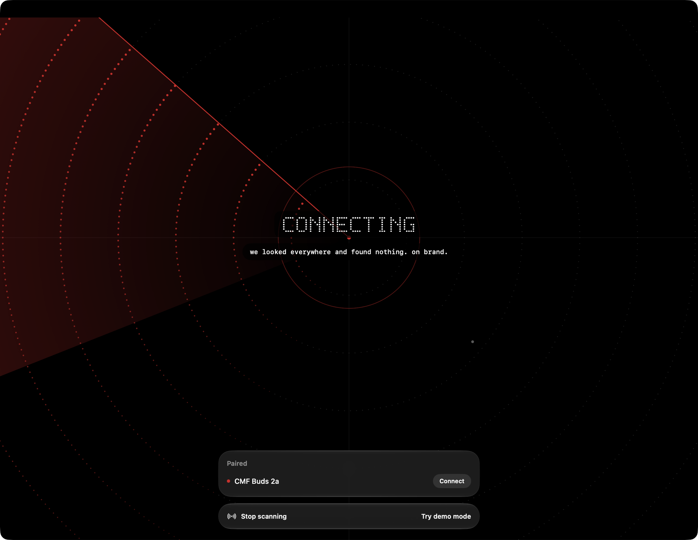

<p align="center"></p>

# NothingController

A native macOS menu bar app for **Nothing** and **CMF by Nothing** earbuds and headphones, styled after the Nothing X app: true black, flat grey cards, a dot-matrix typeface and one red accent. SwiftUI and IOBluetooth, macOS 14+. Unofficial and not affiliated with Nothing.

## Features

- **Menu bar** – battery next to the icon. `L·R` shows one bud icon per side with its own charge (headphones show left and right around a single headset); `AVG` and `MIN` show one figure.
- **Quick panel** – Home, Sound, Control and Device tabs in a 400 × 660 popover.
- **Dashboard** – every panel in one full window, opened from the panel header. It appears in the Dock while open. The device on top, equaliser presets (with an editable graph for Custom), then battery cells with the overall power supply, a vertically scrolling listening-mode selector and a rotary bass knob.
- **Noise control** – a vertically scrolling selector for noise cancel, transparency and off; with noise cancel on, Low, Mid, High and Adaptive buttons appear underneath.
- **Equaliser** – Balanced, Voice, More Bass, More Treble and a 3-band Custom EQ sent to the device. Save, reload and delete your own curves.
- **Enhanced bass** (a rotary knob on the dashboard), **Spatial Audio**, **Low Lag Mode** and **Dual Connection** (read-only on some models).
- **In-ear detection** – pause when you take the buds out. Saved and re-applied every time a device connects.
- **Gestures** – per-earbud double tap, triple tap and press-and-hold, including which noise modes a press cycles through.
- **Find my buds** – ring the left, right or both earbuds.
- **My devices** – switch between paired Nothing and CMF devices, or pair a new one.
- **Device info** – name, model, firmware, serial number and MAC address, plus a raw packet inspector.
- **Scanning empty state** – with nothing connected the whole window is a circular dot radar on black and a bad joke; when a device connects the interface and background reveal with a scale and fade.
- **Demo mode** – simulate a headset without hardware.

Features depend on the model. Anything the device does not report is hidden or disabled.

## Tested on

CMF Buds 2a. Other models use the same protocol family but are untested here; please open an issue with a packet log if something does not work. See [docs/NOTHING-PROTOCOL.md](docs/NOTHING-PROTOCOL.md) for the frame format, command table and what is and is not verified.

## Screenshots

Shown in demo mode with a simulated CMF Headphones Pro.

**Dashboard**



| Sound | Control |
| --- | --- |
|  |  |

**Menu bar panel**

| Home | Sound | Control | Device |
| --- | --- | --- | --- |
|  |  |  |  |

**With nothing connected**



## Requirements

- A Mac running **macOS 14 or later**
- **Xcode 15 or later** (or just the Command Line Tools for the terminal route)
- Nothing or CMF earbuds or headphones, **paired in System Settings > Bluetooth**. No hardware? Use demo mode.

## How to run

```sh
git clone https://github.com/howsillyistoosilly/nothingBluetooth.git
cd nothingBluetooth
```

**Option 1: Terminal (quickest)**

```sh
./build.sh
open .build/NothingController.app
```

`build.sh` builds with SwiftPM and assembles a signed (ad-hoc) `NothingController.app` with the icon and product photos. Look for the headphones icon in the menu bar, with your battery next to it. Quit from the Device tab.

**Option 2: Xcode**

1. Open `CMFControl.xcodeproj` (this builds the real `.app` with the icon).
2. Pick the **CMFControl** scheme and **My Mac** as the destination.
3. Press **Run** (⌘R).

You can also open `Package.swift` and run the `CMFControl` scheme, but that runs a bare executable without the app icon.

**First launch**

- macOS asks for **Bluetooth** permission. Allow it, or the app cannot see your device.
- The app is unsigned for distribution. If macOS blocks it, right-click the app, choose Open, and confirm.
- It runs as a menu bar app with no Dock icon. The Dashboard (expand button in the panel header) shows in the Dock while open.
- The App Sandbox is off because RFCOMM access needs it.

**Try it without hardware**

Open the Device tab and turn on **Demo mode**, or choose "Try demo mode" on the empty screen. Nothing is sent over Bluetooth.

**Troubleshooting**

- **Stuck on "Connecting" or no battery:** quit any other app holding the device's control channel (for example Nothing X on a phone connected to the same earbuds), then reopen this app.
- **Debug a device:** Device tab > Packet inspector shows the raw frames; include them when opening an issue.
- **Xcode shows no run destination:** reopen the project and make sure the scheme is `CMFControl`.

## Project layout

| Path | What it is |
| --- | --- |
| `Sources/CMFControl/Bluetooth` | Connection, RFCOMM channel handling, state |
| `Sources/CMFControl/Protocol` | Frame, CRC and command encoding |
| `Sources/CMFControl/UI` | Menu bar label, popover tabs, dashboard, components |
| `Sources/CMFControl/Resources/Assets.xcassets` | Product photos and the pre-rendered backgrounds |
| `Wallpaper` | `make-wallpaper.swift` and the 3840 × 2160 red-and-black wallpaper (`NothingController-wallpaper.png`) |
| `Icon` | `make-icon.swift` and the app icon |
| `Logo` | `make-logo.swift`, the README banner and transparent white / black wordmarks |

## Credits

- **[nothing-x-macos](https://github.com/nikiomori/nothing-x-macos)** by nikiomori (GPL-3.0). Its work on the Nothing protocol shaped this app: connecting with `openConnection()` before RFCOMM, the custom EQ payload, gesture codes and the find-my-buds command all follow it. Thank you.
- **[Nada protocol notes](https://github.com/chukfinley/nada)**, the **[Nothing Ear (2) Linux write-up](https://bharadwaj-raju.github.io/posts/nothing-ear-2-on-linux/)** by Bharadwaj Raju (packet captures), **[nadamas](https://github.com/ezvk/nadamas)** and **[omarchy-headphones](https://github.com/ncr/omarchy-headphones)** for protocol findings.

## Product images

Product photos were taken from nothing.tech and remain Nothing's property. They are bundled so nothing is fetched at runtime, and are not covered by the license below. Models without a photo fall back to local vector artwork.

## License

GPL-3.0, see [LICENSE](LICENSE). The protocol handling is derived from the GPL-3.0 licensed nothing-x-macos, so this project is released under the same license.

*Nothing, CMF and Nothing X are trademarks of their owners. This project is not endorsed by them.*
